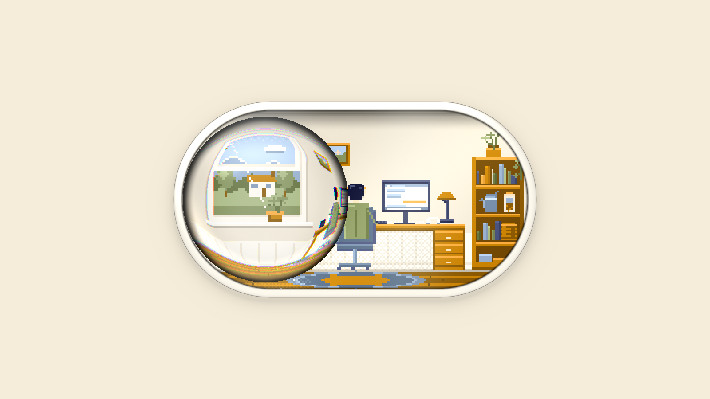

# pixel-art-webgl-component

An agent **skill** for building — and repairing — single-file pixel-art web components with a WebGL2 compositor: a low-resolution painted room, a liquid-glass lens as the control, OKLab palettes with Bayer-dithered time-of-day light, and a story that moves with the slider.

*The reference example at 1600×900: a focus-mode switch whose slider is a liquid-glass lens.*

## What this is

This repository is a skill — a folder of instructions, references, reusable scripts and a complete worked example that an agent (DeepSeek Harness, Claude Code, or any host that reads `SKILL.md`) loads when the task calls for this kind of visual artifact. It is **not** a library or an npm package. What it produces is one self-contained HTML file with no runtime dependencies.

## What it covers

- 5-hue × 4-lightness OKLab palette, gamut mapped by reducing chroma
- Day / dusk / evening / night material columns with 4×4 Bayer replacement — no blended mid-colors
- A 192×112 pixel room plus an apron: window and outdoors, desk, monitor, bookshelf, a person, light and particles
- WebGL2 capsule: beveled shell with a studio reflection, recessed window, liquid-glass lens (flat 1.24× center, compressed rim, ~5% dispersion), light field, two-layer shadows, grain
- A two-road clock: noon → night, and midnight → noon as a different story
- Drag and spring feel; click and keyboard; `role="switch"`, `aria-checked`, `change`, live announcements; reduced motion; pause offscreen
- A 2D canvas fallback and a one-frame blank-render guard
- A verification workflow: headless screenshots, CDP-driven real input, an ASCII pixel inspector, and a blank/beige decision tree

## Contents

| Path | Purpose |
|---|---|
| `SKILL.md` | The skill entry: delivery contract, architecture, workflow, craft rules, quality bar |
| `references/palette-and-dither.md` | OKLab palette, time columns, lighting variants, Bayer key times |
| `references/pixel-world.md` | Buffer/apron, room layout, window/desk/shelf/person recipes, light grid, story states |
| `references/webgl-optics.md` | Capsule/shell/window/lens math, light-field B-spline, shadows, shader robustness |
| `references/interaction-and-a11y.md` | Drag/spring physics, two-road clock, ARIA/change/live region, reduced motion, fallbacks |
| `references/verification-and-diagnosis.md` | Screenshot/CDP harnesses, ASCII inspector, blank/beige decision tree, IE and high-DPI traps |
| `references/worked-example.md` | A map of the reference file: constants, what to adapt, deliberate oddities |
| `assets/reference-focus-switch.html` | The complete 72 KB worked example |
| `assets/preview.png` | The preview above |
| `scripts/shot.ps1` | Headless Chrome screenshots (GPU, SwiftShader, 2D-only, reduced motion, virtual time) |
| `scripts/chrome-cdp.ps1` | Launch a debug Chrome with the DevTools port |
| `scripts/cdp-probe.mjs` | Drive a real click/keyboard, read ARIA and the stage background, capture errors |
| `scripts/verify-html.mjs` | Static delivery gate: inline-script syntax, self-containment, debug leftovers, switch contract |
| `evals/evals.json` | Three prompts for future iterations (new build, blank-page diagnosis, high-DPI/crop repair) |

## Install

Copy or symlink this folder into your skill directory:

- **DeepSeek Harness**: `~/.dsh/skills/pixel-art-webgl-component`
- **Claude Code**: `~/.claude/skills/pixel-art-webgl-component`
- **Other hosts**: follow their convention for a skill folder with `SKILL.md` at its root.

Then ask for a pixel-art WebGL component, a pixel room/diorama, a liquid-glass slider, or paste a symptom such as “the page is only beige”, “it is cropped”, or “it is blurry on a high-DPI screen”.

## Requirements for the verification scripts

- Chrome or Edge (the scripts default to the standard Windows Chrome path; change the `Chrome` parameter if needed)
- PowerShell 7+
- Node.js 22+ for the CDP probe (it uses the built-in `fetch` and `WebSocket`, no packages)
- Python + Pillow only for the ASCII inspector in the verification reference

The generated HTML itself has **no** dependencies and works offline.

## The worked example

Open `assets/reference-focus-switch.html` in Chrome or Edge. On a Windows machine where `.html` is associated with Internet Explorer, double-clicking may open `iexplore.exe` and show only the stage background; that is the viewer, not the file. The verification reference explains how to check and how to open it explicitly.

## Validation

- `scripts/verify-html.mjs` passes on the worked example with 0 warnings.
- The screenshot harness was exercised in SwiftShader, default-GPU, 2D-only and reduced-motion modes.
- The CDP probe verifies that a real click toggles `aria-checked`, that the live region updates, and that the page background follows the night value.
- Three eval prompts are saved for future iterations; a formal with/without-skill benchmark has not been run yet.
